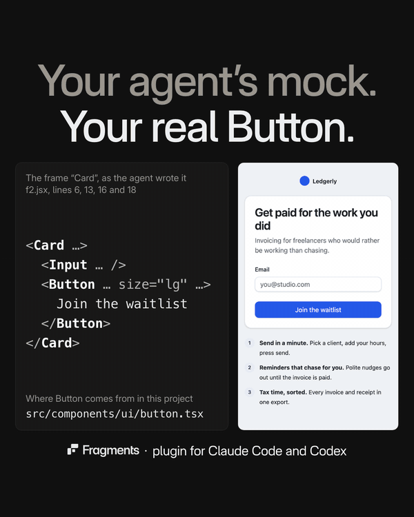

<p align="center"></p>

# Fragments in Claude Code, Codex, and MCP

Prototype on your real React components in ~2 seconds, catch design drift on every edit, and inspect your running app straight from your coding agent. **Free, local, zero sign-in.**

<p align="center"><a href="#install"></a></p>

One ask, three layout directions drawn in seconds on a React project's own `Button`, `Input`, and `Card`, then checked for AA contrast, 4px spacing grid, alignment, and target sizes before any source file changes.

## Install

Needs **Node 22.9+**. Frames and headless inspection use your existing Chrome, Edge, Brave, or Chromium.

### Claude Code (2 commands, no account)

```bash
claude plugin marketplace add fragments-sdk/agent-plugin
claude plugin install fragments@fragments
```

Restart any open Claude Code session.

### Codex (2 commands, no account)

```bash
codex plugin marketplace add fragments-sdk/agent-plugin
codex plugin add fragments@fragments
```

On first launch in Codex, choose **Trust all and continue** when asked to review Fragments hooks (or run `/hooks` and press `t` later).

### Cursor, Antigravity, and other MCP hosts

Clone the repository once:

```bash
git clone https://github.com/fragments-sdk/agent-plugin.git ~/.fragments/agent-plugin
```

Add the stdio MCP server to your host config (`~/.cursor/mcp.json`, Antigravity MCP settings, or any MCP client), replacing `<you>` with your username:

```json
{
  "mcpServers": {
    "fragments": {
      "command": "node",
      "args": [
        "/Users/<you>/.fragments/agent-plugin/plugins/fragments/engine/dist/cli.cjs",
        "mcp",
        "--session",
        "--stdio",
        "--profile",
        "read",
        "--plugin"
      ]
    }
  }
}
```

Cursor, Antigravity, and generic MCP hosts get every Fragments MCP tool. On Windows, use `"C:/Users/<you>/.fragments/agent-plugin/plugins/fragments/engine/dist/cli.cjs"`. Because they do not load Claude Code or Codex turn hooks, ask your agent to run `check` after UI edits. For SHA-256 verification and carried esbuild/Sass/starter assets in projects without their own bundler, launch `plugins/fragments/assets/launch.cjs --receipt-sha256 <hash>` using the hash in `plugins/fragments/mcp/codex.json`.

### One-shot CLI check (any terminal or CI, nothing installed)

```bash
npx -y github:fragments-sdk/agent-plugin .
```

Pass `--since main` to check only new drift on a branch (`--since origin/main` in a CI checkout, which has only the remote's branch; it needs the full history, `fetch-depth: 0` in GitHub Actions), or `--json` for machine-readable output.

## What you get

- **~2s Real-Component Frames:** Ask your agent for 2 to 3 layout directions, or every screen state like empty, loading, and error. It renders them in headless Chrome on your real React components and tokens under `~/.fragments/frames/`. Each frame is checked for AA contrast, 4px grid spacing, alignment, targets, and props before touching code.
- **Self-Growing Contract + One Drift Engine:** Drift is code that leaves your tokens and components. Fragments infers rules from your repo, checks every edit, and ends with a receipt (`Fragments receipt: 3 fixed, 1 kept, 0 open`). Open `contract_review` for swatches, Unified/Split diffs, and Undo, or run `--since <base>` in CI.
- **Headless browser inspection (`open`, `read`, `act`, `see`, `judge`, `page_map`):** Drive your dev server, inspect routes, check accessibility and console errors, and run visual audits from your terminal.
- **Live Multi-Page Canvas (with free Fragments Desktop):** View every running page across desktop and phone widths at once, including behind sign-in. Click any element for its React file and line, measure spacing, or force interactive states. Turn a picked frame into real code (`frame_use`) with diffs and Undo.
- **Hosted Review Links -> Back to Agent (with Fragments Desktop):** Share a review link (`link_publish`) so teammates inspect and pin comments in any browser with no install. Pull threads into your agent (`link_review`), push updates (`link_revise`), and resolve threads (`link_resolve`). Free: 3 new links a month. Pro: no limit.
- **Free Zero-Login Plugin + Built-in Record:** The plugin is free with no sign-in required. Pair it with the free **Fragments Desktop** app (Mac Apple Silicon and Windows x64) for Canvas and Review Links. Use built-in Record (`record_start`, `record_stop`, `record_list`) for clean MP4 turn walkthroughs.

**[Download Fragments Desktop for Mac or Windows ->](https://www.usefragments.com/download?utm_source=github&utm_medium=readme&utm_campaign=nov-100)**

## Try it in 30 seconds

1. **Test live drift catching:** Ask your agent *"add a small footer with `padding: 20px` and `#6b7280` text"*. It names the Fragments finding right after the edit.
2. **Test real-component Frames:** Ask your agent *"draw 3 layout directions for a settings header using our existing components before editing any files"*.

## Plugin only vs. with Fragments Desktop

| Capability | Plugin only (zero sign-in) | With Fragments Desktop |
| --- | --- | --- |
| Draw, audit, and export real-component Frames | Yes | Yes + live canvas and Pick -> Build (`frame_use`) |
| Live edit checks, receipts, and GitHub CI | Yes | Yes + visual Drift view |
| Contract review panel, save, and Undo | Yes | Yes |
| Headless browser (`open`/`read`/`act`) and `page_map` | Yes | Yes |
| Visual `see` and `judge` on localhost | Yes (drift + detail audit) | Yes (ask judge, interactive states, signed-in pages) |
| Live multi-page canvas, before/after Undo, built-in Record | No | Yes |
| Hosted review links (`link_publish`, `link_review`, `link_revise`) | No | Yes (Free: 3 new links a month; Pro: no limit) |

## Privacy and what it touches

- **Runs locally and sends nothing off your machine.** The plugin makes no network calls and fetches no updates. Updates come through your host.
- **Never edits your repo silently.** Contract and CI writes (`fragments.config.json`, `.fragments/*`, `AGENTS.md`/`CLAUDE.md`, GitHub Actions check file) require your confirmation in the review panel or host dialog. Nothing is committed.
- **Keeps working state outside your project:** `~/.claude/plugins/data/fragments-fragments` (or `~/.fragments/agent-state`), `~/.fragments/frames/`, and `~/.fragments/runs/`. Delete those folders any time to reset.
- **Exceptions only when you explicitly ask:** `frame_from_page`, `open`, `read`, `act`, and `set` open the URL you pass in headless Chromium; `judge`, `take`, `frame_use`, `record_start`, and `link_*` talk locally to the open Fragments Desktop app.

## More

[Full reference and troubleshooting](https://github.com/fragments-sdk/agent-plugin/blob/main/REFERENCE.md) · [Changelog](https://github.com/fragments-sdk/agent-plugin/blob/main/CHANGELOG.md) · [Report an issue](https://github.com/fragments-sdk/agent-plugin/issues) · [usefragments.com](https://usefragments.com) · hello@usefragments.com

## License

Free to use for your own projects, including commercial ones, under the Fragments Local Use License; see [LICENSE](LICENSE).
